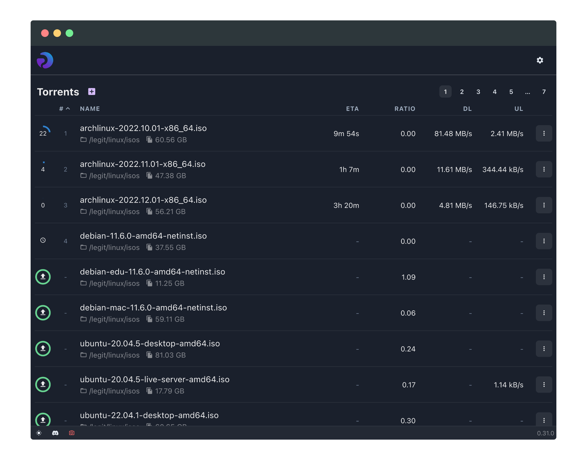

<h1 align="center">
  <br/>
  Porla
</h1>

<p align="center">
  <a href="https://discord.gg/FNVVRzqJAG">
    
  </a>
  
</p>

Porla is a powerful BitTorrent client with high performance and low memory
usage. It is designed for headless operations on servers and seedboxes and can
easily manage tens of thousands of torrents.

The focus of Porla is to provide a BitTorrent client that is _fast_, _correct_
and _extensible_.

<p align="center">
   <br/>
</p>

### Features

- Based on libtorrent with support for both BitTorrent v1 and v2.
- Lua API for writing [plugins](https://porla.org/plugins).
- Supports multiple, distinct sessions with different settings.
- Embedded query language to find torrents. Fast.
- [JSONRPC API](https://porla.org/api/auth) JSON-RPC API with user logins and API keys.
- Modern web UI.

#### Plugins

The Lua API can be used to automate and integrate Porla with all types of
applications and services, such as Discord and [ntfy.sh](https://ntfy.sh).

#### Multiple sessions

You can easily set up multiple sessions to separate your public torrents from
your private torrents, for example. Each session binds to its own network
device and port pair, and can have custom rate limits, queueing rules, etc.

#### The Porla query language (PQL)

To make it easy to navigate and filter a large amount of torrents Porla has a
simple, embedded query language named PQL.

With PQL you can easily find torrents matching specific criterias.

## Getting started

Download the latest release and put it somewhere safe. Then, run it. By default,
Porla binds the web UI to `localhost:1337`. On first use you will be prompted to
set up a user account.

```shell
porla
```

To show all options available, suffix with `--help`.

```shell
porla --help
```

For example, you can run `porla` with an in-memory SQLite database by passing
`--db=:memory:`.

```shell
porla --db=:memory:
```

## Configuration

You can configure Porla with environment variables and command line arguments.

Command line arguments have the highest priority, then the environment
variables. The app will, however, run without any applied configuration and use
sensible defaults instead.

### Environment variables and command line args

- `PORLA_CONFIG_FILE` or `--config-file` - path to a TOML config file with
  additional configuration.
- `PORLA_DB` or `--db` - path a file (which does not need to exist) that `porla`
  will use to store its state.
- `PORLA_HTTP_BASE_PATH` or `--http-base-path` - set to a path where the HTTP parts
  of Porla will be served. Defaults to `/`.
- `PORLA_HTTP_HOST` or `--http-host` - set to an IP address which to bind the HTTP
  server. Defaults to _127.0.0.1_.
- `PORLA_HTTP_PORT` or `--http-port` - set to the port to use for the HTTP server.
  Defaults to _1337_.
- `PORLA_LOG_LEVEL` or `--log-level` - the minimum log level to use. Valid values
  are _trace_, _debug_, _info_, _warning_, _error_, _fatal_. Defaults to _info_.
- `PORLA_SECRET_KEY` or `--secret-key` - the key that signs login tokens. If
  it's not set, Porla generates one at each start, which logs users out on every
  restart. API keys aren't affected. Generate one with `openssl rand -hex 32`.
- `PORLA_STATE_DIR` or `--state-dir` - a path to a directory where Porla will
  store its state.

Refer to [the official documentation](https://porla.org/configuration/) for
a deeper dive.

## Development

```sh
cmake --preset debug
cmake --build --preset debug
ctest --preset unit
```

The following dependencies needs to be installed manually;

- Boost
- libcurl
- libsodium
- libmaxminddb
- Lua 5.4
- OpenSSL
- SQLite
- zlib

### Generating ANTLR4 grammar source files

This is only needed when `PorlaQueryLang.g4` is modified.

```shell
wget https://www.antlr.org/download/antlr-4.13.2-complete.jar
pushd src/query
java -jar ../../antlr-4.13.2-complete.jar -Dlanguage=Cpp -no-visitor -no-listener -o _aux PqlLexer.g4 PqlParser.g4
popd
```
